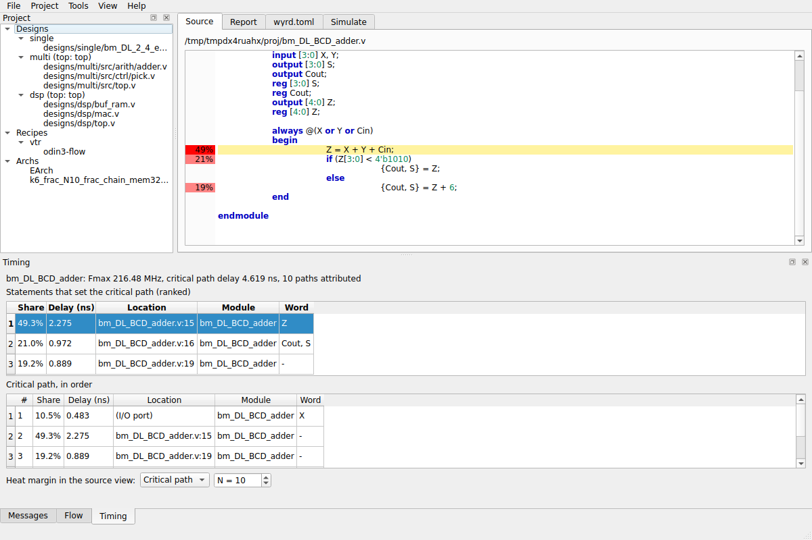

# The GUI

```bash
wyrd-gui [PROJECT_DIR]
```

A step-by-step PDF tutorial does everything below in the interface, with a figure for each step:
[wyrd-gui-tutorial.pdf](https://drpaj12.github.io/wyrd/wyrd-gui-tutorial.pdf).

`wyrd-gui` needs the `gui` extra (PySide6). Without an argument it opens the last project (if its
`wyrd.toml` still exists). Run it inside WSL: WSLg shows the window.

## Layout, View menu and zoom

Every panel is a dock: drag its title to move it, drag the borders to size it, use the title
buttons to float (detach) or close it, and **View > Panels** to bring a closed one back. There is no
fixed central area, so any panel, such as Mímir, can fill the window on its own.

- **Maximise**: View > Maximise current panel (F11 or Ctrl+Shift+M), or double-click a dock title or
  tab. The same again restores. The current panel is the one with the keyboard
  focus, else the last one focused, else the one under the mouse, else the largest panel shown.
- **Layouts** (View > Layout): *Project* (default), *Timing + source*, *Mímir explorer*,
  *Everything tabbed*, and **Reset layout**. The active layout has a check mark; it is cleared when you move a dock. The last layout is
  saved on quit and restored; a saved layout from another version is ignored. A detached (floating)
  panel that would open off every screen is brought back onto the main screen.
- **Zoom**: View > Zoom in / out / reset (Ctrl+= or Ctrl+Shift+=, Ctrl+-, Ctrl+0), or Ctrl+wheel over
  a text or table, changes the size of the text in code and text editors, logs, tables, lists and
  trees of every panel. Buttons, labels, menus and the About headers keep their size. The size is
  remembered.
- **About headers**: each panel starts with a collapsible About header (what it shows, why use it,
  what you will see, how to read it). Its state is remembered; View > About headers shows or hides
  all. Help > Wyrd guide holds the same text.

On WSLg start the GUI with `QT_QPA_PLATFORM=xcb`: the Wayland plugin crashed on maximise with an
xdg_surface size error. The code does not set the platform itself.

## The window

- **Project** (left dock): the project as a tree of Designs (with their files), Recipes (with their
  steps) and Archs. Double-click a file to open it in the Source tab.
- **Tabs** (centre): *Source*, *Report*, *wyrd.toml* and *Simulate*. When `wyrd.toml` has an error only the
  *wyrd.toml* tab is enabled.
- **Messages**, **Flow**, **Timing**, **Schematic**, **Atlas** and **Mímir** (bottom docks, tabbed; View menu shows or hides them).

### Source

A read-only view of a Verilog file with syntax colours. Double-clicking a message or a diagnostic
that names a file and line opens the file there.

### wyrd.toml

An editor for the project file with live validation. After you stop typing it parses the text as
`wyrd run` would: a valid file shows how many runs it expands to, an error shows the message and
highlights the line (click the message to jump to it). Ctrl+S saves; a file that does not validate
asks before saving. After a valid save the project reloads. **Project > Add design...** opens a
dialog (name, files, top module, "Add to [sweep] design") that appends a `[[design]]` block to the
editor text; it stays unsaved until you save.

### Flow

The Flow dock runs `wyrd run` as a subprocess, so the GUI and the command line behave the same:

- **Run** (Ctrl+R) and **Cancel** (Ctrl+.). Cancel stops the running steps; finished runs stay.
- **Force** re-runs runs that are already `ok` (`--force`).
- **Jobs** and **Memory budget** override the machine settings for this run (empty or 0 keeps them).
- A progress bar counts finished runs and the log shows the command's output.

Run is disabled while the project has a configuration error. The window asks before quitting
during a run.

### Report

When a run exists the Report tab shows a tree of results: *All runs* (the table `wyrd table` prints),
and for every run a *Summary*, one node per *Step n: tool* with its log files, and *Compare*.

- **Summary** is a Quartus-style table: Status, LUTs, CLBs, the hard blocks, Fmax (MHz) (computed
  as 1000 / critical path in ns), minimum channel width, critical path (ns), run directory and run key.
- A **log** node shows the file (`odin3.log`, `vpr.log`, `stdout.log`, ...). The Messages dock lists
  the warnings and errors parsed from the selected run's logs; filter All, Errors or Warnings, and
  double-click a row to open its location.
- **Compare** with another project directory fills a table like `wyrd compare` and lists runs found
  in only one project.
- **Floorplan** re-runs VPR with its graphics for the selected run, using the VPR set as
  `tools.vpr_gui` in the machine settings, else the VPR named in the run's log. It needs a VPR built
  with Qt6 graphics; set one up as in [Floorplan viewer (VPR graphics)](getting-started.md). When VPR
  exits early the Flow log says so and names the setting. The button is disabled, with the reason
  as its tooltip, when `vpr_gui` is set to a file that does not exist.

Project > Refresh results (F5) re-reads `wyrd.db`; it also happens after each flow run.

### Timing

For a run whose `odin3-flow` step has `timing_attr = true` (see {doc}`running`), the **Timing** dock
shows the critical-path attribution of Odin III (`timing/attribution.json`): a header with Fmax and the
critical path delay, the statements that set the critical path ranked by share (share, delay,
`file:line`, module, word), and the critical path in order. Selecting a row opens the file in the
Source tab at that line. The Source tab then shows a heat margin with a percentage per line; the
dock chooses its scope: *Critical path* (share of the critical path delay) or *Top paths* (share of
the delay of the worst N paths). The view is read-only. A run without an attribution, or with a file
Wyrd cannot read (an unknown `schema_version`, bad JSON, over 64 MiB), shows a plain message instead;
when the flow left a `timing.log`, the message gives its text. Source files are looked up only
inside the project directory and the design directories, using the `designs` and `source_cwd`
recorded in `timing/inputs.json` first; a bare file name matches only when exactly one file has
it. The Timing dock warns when you select a line of a file that is newer than the attribution.



## Menus

| Menu | Items |
|---|---|
| File | New Project... (runs `wyrd init` in a folder you choose), Open Project... (Ctrl+O), Recent, Save wyrd.toml (Ctrl+S), Quit (Ctrl+Q) |
| Project | Run flow (Ctrl+R), Cancel (Ctrl+.), Refresh results (F5), Add design..., Settings... |
| Tools | Simulate (Ctrl+T), Midgard III (Verilog Town), Midgard III Level Editor |
| View | show or hide the docks |
| Help | About (credits of the tools and papers Wyrd builds on) |

**Settings...** edits `machine.toml` (the table of {doc}`getting-started`) with one field per key.
The Simulate and Midgard entries are covered in {doc}`simulation` and {doc}`midgard`.

### Mímir panel (browse the Mímir dataset)

File > Open Mímir store... (or the button in the Mímir dock; *Reopen last* remembers the last
store) opens a Mímir SQLite store, schema version 4, read only: Wyrd never writes it and never
builds an index, so a store that another process is writing can be browsed. The left list holds
designs (source box and filter; at most 500 shown). Tabs: *Summary* (row counts, sources, levels);
*Design* (metric records with unit, measurer and origin; runs, double-click one to open it; design
meta and lineage with how each field is known; structure counts); *Run* (flow parameters coloured
given green, default grey, default-unrecorded amber, unknown red; artifacts; *Fetch artifacts...*
runs `mimir fetch` and is disabled when `mimir` is not on PATH); *Compare* (source prefix, base
config `source/arm`, metric, optional level: the geometric mean of value / base over the designs
both configs have, with n, as a table and a dot chart); *Plot* (scatter of two metrics, one point
per design, optional log axes, hover names the design). Every table has Copy and Export CSV.
The same data is on the command line: `wyrd mimir` (see `running.md`). Spec:
`docs/specs/2026-10-28-mimir-browser.md`.

## Wyrd guide

<!-- wyrd-guide:begin -->
## Wyrd guide

Wyrd is a window onto your project: its files, its runs, what the tools said, how fast the circuit is, and what a Mímir store knows. Every part of the window is a panel. Each panel has an About header with the four parts below. View > Panels shows or hides a panel, View > Layout chooses a layout, F11 makes one panel fill the window, and zoom changes the size of the text in the code and text editors, logs, tables, lists and trees of every panel (Ctrl+= or Ctrl+Shift+= bigger, Ctrl+- smaller, Ctrl+0 normal, or hold Ctrl and turn the mouse wheel over a text or table). Buttons, labels, menus and the About headers keep their size.

## The panels

### Project

**What this shows.** Your project as a tree: the designs (circuits) with their source files, the recipes (the steps the flow runs) and the architectures (the target chip descriptions).

**Why use it.** Find a file of your project quickly and open it, without a file dialog.

**What you will see.** Three groups: Designs (each with its files), Recipes (each with its steps) and Archs. The tree is empty until a project is open (File > Open Project).

**How to read it.** Double click a file to show it in the Source panel. A recipe is an ordered list of tools (for example synthesis then place and route); an arch is the chip the circuit is built on.

### Source

**What this shows.** The text of one Verilog file, read only, with syntax colours. When a timing run is loaded it can also paint the text hot (red) or cold (blue).

**Why use it.** Read the code that a message, a path or a table row points at, and see which parts of it decide the speed of the chip.

**What you will see.** The file name, the code, and a margin with a share per line. With hot/cold on you also see a colour bar (blue to red) with a theta line, coloured words, small strips under buses, and dotted underlines.

**How to read it.** Red means critical: the signal lies on a path that limits the clock speed. Blue means not critical: lots of spare time. The criticality (crit) is how close a path is to being the slowest one: 0 (blue) has lots of spare time, 1 (red) is the slowest. Theta is the near-critical threshold (0.90, 0.95 or 0.99): paths with crit at least theta count as near-critical. A bit strip under a bus word has one small box per bit, most significant bit first (the MSB first box in the Timing panel changes that), each coloured by that bit's crit. A dotted underline marks a bit whose index is unknown; such a bit is grey. Separately: the columns of a word are always found by matching its name on the line.

### Report

**What this shows.** The results of the runs of your project: one tree entry per run and, for the selected run, its table of numbers, its log, or a comparison with another project.

**Why use it.** See whether a run worked, what it measured, and how it compares, without opening files.

**What you will see.** A tree of runs on the left; on the right a table of metrics (such as area and delay), a log page, and a compare page. A Floorplan button opens the chip layout of a run.

**How to read it.** A run is one execution of the flow with one set of settings. Select a run to load its messages and timing into the other panels. A failed run shows its log.

### wyrd.toml

**What this shows.** The project file wyrd.toml: it says which designs, settings and recipes the runs use.

**Why use it.** Change what the project runs. The text is checked while you type.

**What you will see.** A text editor, a status line (the number of runs the file expands to, or the error) and a Save button.

**How to read it.** A green status gives the number of runs. A red status names the problem and its line; click it to jump there. Ctrl+S saves. After a valid save the project reloads.

### Simulate

**What this shows.** Run a design in a simulator and watch its signals change over time, like a logic analyser.

**Why use it.** Check that a circuit does what you expect, step by step, before you build it.

**What you will see.** Controls (compile, step, run, reset), a table of signals with their values, a waveform and a list of diagnostics. Test vectors can be loaded or generated.

**How to read it.** A step is one clock tick. A waveform is a signal's value drawn against time. A vector is one set of input values to apply. Radix chooses how numbers are shown (binary, decimal, hexadecimal).

### Messages

**What this shows.** The warnings and errors that the tools printed when they ran the selected run.

**Why use it.** Find what went wrong, or what the tools were unsure about, and jump to the line.

**What you will see.** A table with the severity, the tool, the text, and the file and line when there is one.

**How to read it.** Errors stop a run, warnings do not. Double click a row that names a file to open it at that line in the Source panel.

### Flow

**What this shows.** The control for running your project's flow: the same as the wyrd run command.

**Why use it.** Start, watch and stop the runs from the window.

**What you will see.** Run, Cancel and Force controls, the number of jobs and the memory budget, a progress line and the output of the running steps.

**How to read it.** Jobs is how many runs go at once; the memory budget stops too many big runs from starting together. Force repeats runs that already finished OK. Cancel keeps finished runs.

### Timing

**What this shows.** The timing of the selected run: how long the slowest paths are and which parts of the HDL they go through.

**Why use it.** Find the signals, lines and modules that set the speed of the chip.

**What you will see.** A summary, a table of paths and objects, and controls that choose how the Source panel is coloured (by margin, hot/cold, or both) and which paths count.

**How to read it.** Slack is the spare time of a path: negative means the path is too slow. Crit is how close a path is to being the slowest one: 1 is the slowest, 0 has lots of spare time. It is 1 - slack / (the largest required time of its clock pair); when the worst slack is negative, all slacks are shifted so that the worst is 0. Near-critical means crit is at least theta. MSB first (a setting here) chooses the bit order of the bit strips. Click a coloured word in the Source panel to list its paths.

### Schematic

**What this shows.** A drawing of the gates and wires of one module of a synthesised netlist.

**Why use it.** See the structure the tools built from your code.

**What you will see.** A module chooser, Open netlist and Draw buttons, and the drawing. Each gate is a box, each wire a line.

**How to read it.** A netlist is the circuit after synthesis, written as gates and wires. Large modules are drawn in pieces; use the scroll bars or zoom.

### Atlas

**What this shows.** A map of where the parts of the circuit were placed on the chip, and how that changed between two settings.

**Why use it.** See whether different placement settings put the logic in different places.

**What you will see.** File and design choosers, two arm choosers (A and B, the two settings compared), a scan button and grids of the chip.

**How to read it.** A placement is the position of every block on the chip grid. An arm is one setting of the experiment. Brighter cells hold more blocks or moved more between the arms.

### Mímir

**What this shows.** A viewer for a Mímir store, a database of measured values of many circuits: size, speed, and how the HDL turned into logic.

**Why use it.** Compare experiments, look at one circuit in depth, and send timing to the Source panel.

**What you will see.** A list of circuits on the left and tabs on the right: Summary, Design, Run, Compare, Plot, Structures, Timing. Each tab has its own About header.

**How to read it.** The store is opened read only: Wyrd never changes it. Start with File > Open Mímir store, then read the Summary tab. Click a circuit; the Current design line above the tabs names it. To see the colour of its HDL (red = slowest, blue = spare time) press Show HDL heat (hot/cold) beside that line; it is grey, with a tooltip, when the circuit has no timing. List entries marked 'timing' carry it.

## Mímir guide: from a store to a coloured source file

Mímir is a database of measured values of circuits: how big they are, how fast, how their HDL
turned into logic. Wyrd shows it read only: it never changes the file.

### 1. Open a store

File > Open Mímir store... and choose a `.db` file. The Summary tab says what is in it: records
(measured values), runs (executions of the flow) and sources (experiments).

### 2. Pick a design

Choose a source and type in the filter box, then click a circuit. The Design tab fills in. Double
click a run in its Runs table to see exactly how the run was made (Run tab).

The same circuit can be listed once per source. Only the entries that carry timing end in the word
"timing" (for example `mkPktMerge [mimir-structures]`). The line above the list says "Current
design" and always names the highlighted entry. Typing in the filter box or changing the source
never changes the current design; only your click (or the arrow keys on the list) does. When you
pick an entry without timing, the Timing and Structures tabs use the timing of the same circuit
from another source and say so. "Reopen last" opens the last store with the last design selected.

### 3. The Timing tab

Pick a run. The summary line gives the clock period (CPD), the worst slack and how many of the
reported paths were used. Criticality (crit) is how close a path is to being the slowest one: 1.0
is the slowest, 0 has plenty of spare time. It is 1 - slack / (the largest required time of the
clock pair of the path); when the worst slack is negative, all slacks are shifted so that the
worst is 0. A path is near-critical when its crit is at least
theta (0.90, 0.95 or 0.99). The histogram shows how many paths fall in each crit range; the
table lists the most critical HDL objects, with a bit strip for buses.

Exact or lower bound: when the summary says "crit is exact", the clock period was found from all
paths. When it says "crit is a lower bound (dmax from report)", it came from a cut report and the
true crit can only be higher.

### 4. See the HDL heat: Show HDL heat (hot/cold)

Press "Show HDL heat (hot/cold)", the button beside the Current design line (it is always there;
the "Open in source view" button of the Timing tab does the same). It is grey when the current
design has no timing; hover over it to see why. Wyrd finds the design's source from the store
(the design's origin, for example `$VTR_ROOT/vtr_flow/benchmarks/verilog/mkPktMerge.v`;
`$VTR_ROOT` comes from your environment or the machine settings), opens it read only, switches the
Timing panel to near-critical, and selects the hottest token. When the file cannot be found the
status line says exactly what is missing and a file dialog lets you pick it.

### 5. What red and blue mean

Red is critical (crit near 1), blue is not critical, light yellow is in between. A faint tint
on a whole line says the line is on a near-critical path. For a bus such as `D_OUT[141:0]` the
name is split into one coloured piece per bit, most significant bit first: a name of 6 letters
for 3 bits gives 2 letters per bit. When the name is shorter than the number of bits, a bit
strip under the name shows each bit and the name keeps the highest crit. A dotted underline
marks a bit whose index is unknown; such a bit is grey. Hover a token to see its crit and every
bit.

The token columns are always found by matching the name of the word on the line (the store
links a word to a line, not to a column). The Timing panel setting "MSB first" chooses whether
the bits run from the most or the least significant bit.

### 6. Example: mkPktMerge

Open `lane3-structures.db`, click `mkPktMerge` (either entry; the one marked "timing" owns the
data), choose a run in the Timing tab if you want another one, and press Show HDL heat. The word
`fi1__D_OUT` is a bus of at least 142 bits. Bits 134 and 141 have crit 1.0 and bit 132 has 0.995:
those bits set the speed of the chip, while many others sit near 0.93. Click the token to list the
paths through it in the Timing panel.

### 7. Structures tab

A structure is a piece of HDL that looks like a known building block (an adder, a multiplexer).
Each row says how many LUTs and CLBs it became, where it was placed (bbox), its spread (how far
apart its parts are) and crit_share (how much of the critical path it accounts for).
<!-- wyrd-guide:end -->
