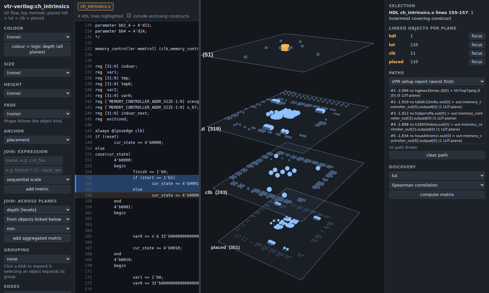
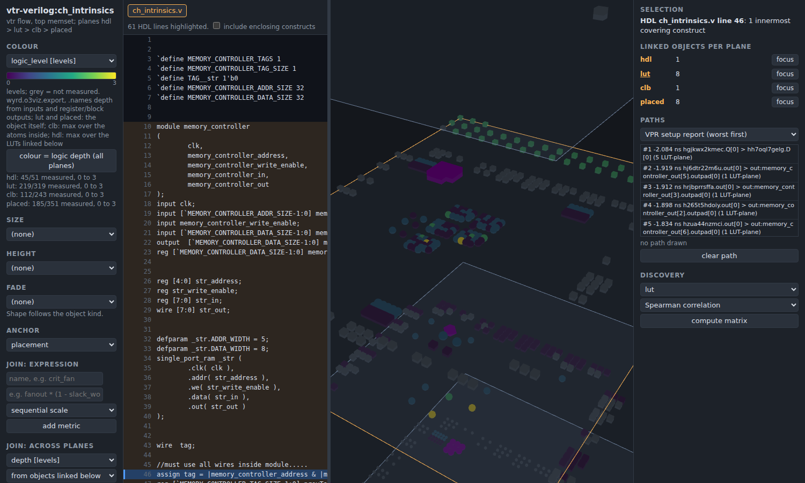
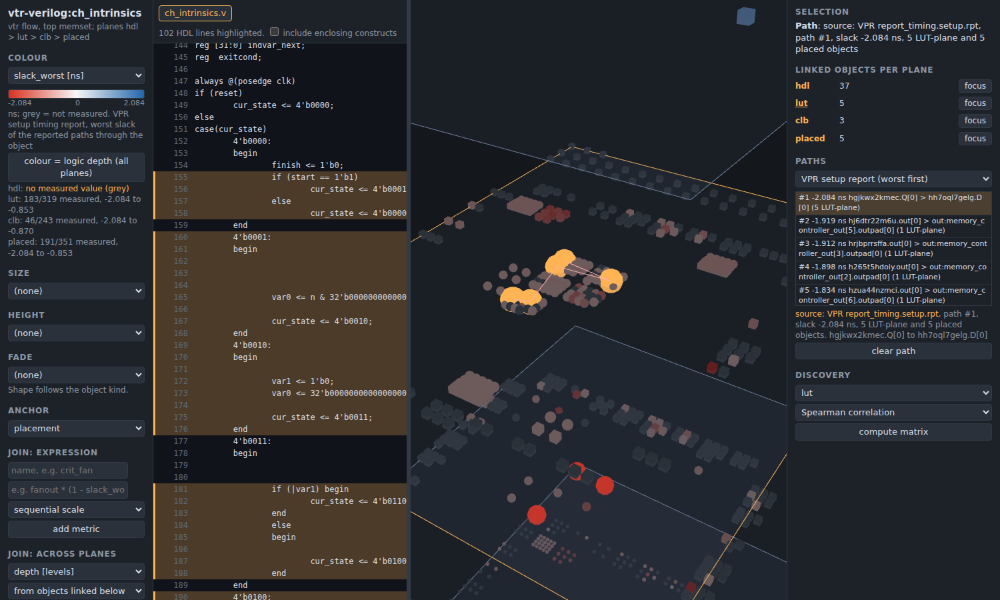
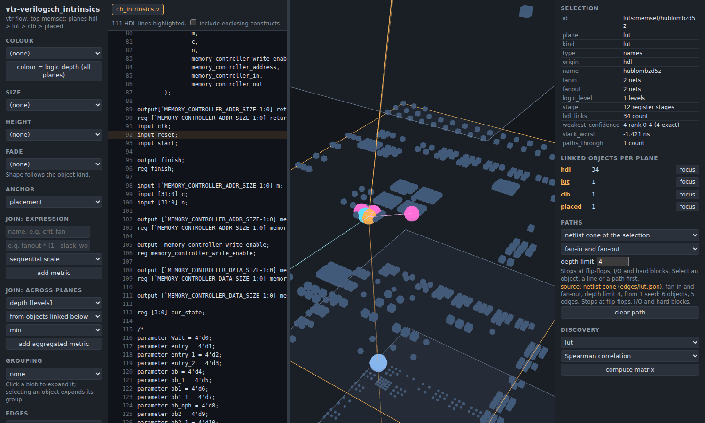
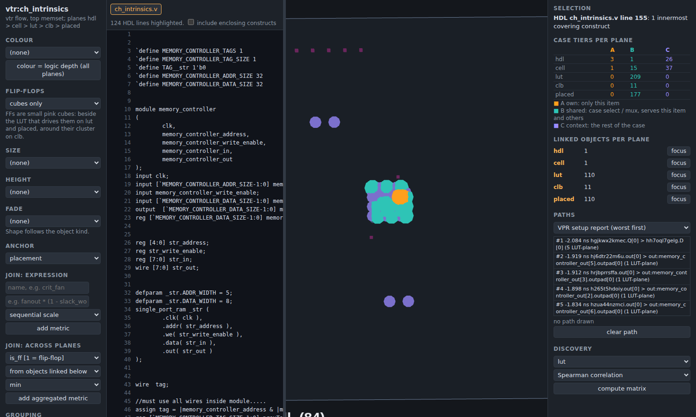
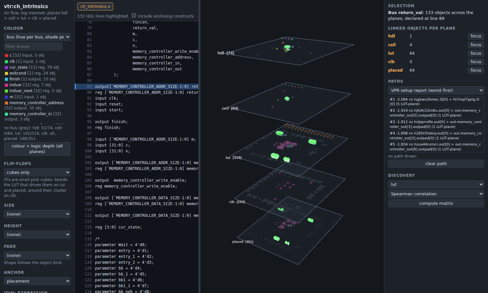
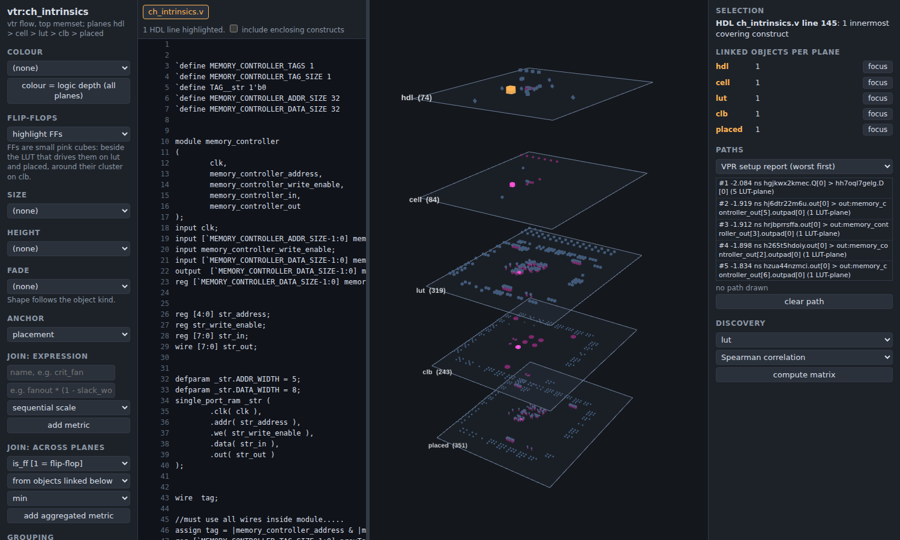

# o3viz: the 3D provenance viewer

o3viz shows one benchmark as a stack of planes in a web browser: the HDL constructs on top, then the LUTs
Odin III made, the VPR clusters, and the placed atoms on the real FPGA grid at the bottom. Each plane can be
coloured and sized by any measured parameter, and a click on an object highlights its column through all the
planes and shows the HDL lines behind it. Design: `docs/specs/2026-11-03-o3viz-design.md`.

## Make a bundle

Run the benchmark through the Odin III flow with provenance and keep VPR's files, then add the placement
records and the step files (the Odin III tools are `odin3-flow`, `odin3-prov-post`, `odin3-prov-steps`):

    odin3-flow design.v --prov --keep-results --out RUN
    odin3-prov-post RUN
    odin3-prov-steps RUN
    wyrd viz export RUN --out design.o3viz --benchmark vtr-verilog:design --src DIR_WITH_design.v

The bundle is a directory of JSON files (`manifest.json`, `planes/`, `links.json`, `edges/`, `anchors/`, `hdl/`),
deterministic: exporting twice gives the same bytes. A value that was not measured is `null` and shows grey.

## View it

    wyrd viz serve design.o3viz            # prints http://127.0.0.1:8765/ (use --port N for another) ; open it in a browser

Everything is served locally; three.js is vendored (`wyrd/o3viz/web/vendor`, MIT), nothing is fetched from a
network.

- Source pane (left, 40% of the width; drag the divider to resize): the whole HDL file with line numbers, tabs
  for several files. Click a line, or drag or shift-click a range. The constructs whose span covers the lines
  (the innermost ones; tick "include enclosing constructs" for all) are selected, then every linked object on
  the planes below (LUTs, clusters, placed atoms) through the links. They are highlighted in 3D, the rest is
  dimmed, and the right panel shows one count per plane. Clicking an object in 3D does the reverse: its HDL lines
  are highlighted in the pane and scrolled to.
- Drag to rotate, right-drag to pan, "auto-rotate" and "plane gap" are in the left panel.
- Plane control: keys 1 to N focus a plane (the orbit target moves to the plane centre), 0 is the whole stack;
  the "focus" buttons in the Planes list and in the right panel do the same. The wheel zooms towards the point
  under the cursor on the focused plane (or the nearest plane when none is focused). Each plane has show,
  opacity and "solo".
- Colour: any metric. Slack uses a diverging scale (red is negative). Grey means not measured. "colour = logic
  depth" sets the colour to `logic_level` on all planes; the legend lists, per plane, how many objects have a
  measured value and the range, and says "no measured value" when a plane has none.
- Size: any metric.
- Click an object: the right panel shows its fields and metrics and one line per plane (count of linked objects
  and a focus button). Click empty space to clear.

### Paths

The Paths section draws combinational paths as polylines through the objects they pass on the lut and placed
planes, and highlights the HDL lines they come from. The source is always labelled.

- VPR setup report: the reported setup paths (`report_timing.setup.rpt`, kept in `paths.json`) sorted by slack,
  worst first. Click one to draw it. Only the data-arrival part is used; clock-network pins are left out.
- Netlist cone: from the selected objects (an object, a line, a path), the fan-in, fan-out or both cones in the
  LUT netlist (`edges/lut.json`), with a depth limit. The cone stops at flip-flops, I/O and hard blocks, which
  are shown as its boundary. It follows the selection while this source is chosen.

## What a plane is

| Plane | Objects | Position under the `placement` anchor |
|---|---|---|
| `hdl` | HDL constructs (module, block, statement) from the step file `read` | centroid of the LUTs whose chain reaches it |
| `lut` | nets and LUTs of the mapped netlist (step file `map`) | the placed atom with the same name |
| `clb` | VPR top-level blocks (logic clusters, IO pads, memories) from the `.net` | centroid of the atoms inside |
| `placed` | one per atom (step file `place`) | the real VPR grid tile of its cluster, spread inside the tile |

Planes that Odin III's step files do not write yet (`ir`, `gates`, `ble`, `routed` in v1.4) are not shown; the
manifest lists them as missing. Objects with no placed atom (nets that mapping removed) are put at the mean of
their placed neighbours or the grid centre and counted as `unanchored` in the manifest.

## Anchors (layouts)

The anchor decides where each object sits on its plane; the dropdown switches it without reloading.

- `placement`: the real grid at the bottom; upper planes at the centroid of what they link to.
- `ast`: the HDL construct tree (tidy tree, root on top, one leaf per column); a LUT sits at its deepest
  construct, a cluster at the mean of its LUTs, a placed atom with its LUT.
- `pipeline`: x = register stage (a flip-flop or a block output adds one to the deepest input stage), one square
  block per stage, atoms ordered by logic level inside it; upper planes at the centroid.
- `level`: x = logic level (LUT depth from inputs and register or block outputs), one square block per level,
  atoms ordered by worst slack inside it (worst first, not measured last). It is not yet slack-weighted.

Objects that have no position of their own (a net that mapping removed, an IO pad with no placed atom in an anchor
that needs one) are moved to a strip below the plane and counted in the manifest; a guess is never drawn as a
measurement.

## Channels and joins

Colour, size, height above the plane and fade (blend to the background) take any metric; the shape follows the
object kind. Two joins build new metrics, which then appear in every dropdown:

- Expression: a name and a formula over metric names, for example `fanout * (1 - slack_worst)`. Operators
  `+ - * / % ^`, comparisons, and `abs sqrt log log2 exp floor ceil round min max pow clamp if`. It is parsed by
  a small parser of its own (`wyrd/o3viz/web/expr.js`, no `eval`). A missing value gives a missing result.
- Across planes: `min`, `max`, `mean`, `sum` or `count` of a metric over the objects linked below (for an HDL
  construct, its LUTs) or above (for a LUT, its constructs). Direct links only, one hop.

## Exploring a bigger design (M3)

- Discovery panel (right): pick a plane and Spearman correlation or mutual information (8 equal-width bins, bits);
  it shows the matrix of the metrics with 10 or more values. Click a cell: colour = row metric, size = column
  metric. Pairs with a missing value on either side are left out.
- 2D view: "View" shows one plane from above (rotation off). Morph: choose two adjacent planes and drag the slider;
  the lower plane rises to the upper one and its objects slide to the centroid of the upper objects they link to.
- Brush: hold Shift and drag a rectangle; the objects of the chosen plane inside it are selected and their linked
  objects on the other planes are highlighted (counts in the right panel).
- Edges: "k-hop of selection" draws the netlist edges within k hops of the selected LUT-plane objects (loaded on
  demand); "between groups" draws one line per pair of groups, brighter for more edges.
- Grouping: by HDL module or by VPR cluster, one blob per group on the lut and placed planes (colour = mean of the
  colour metric); click a blob to expand it; selecting an object expands its group.

Large benchmark used: VTR `sha` (1289 LUTs, 142 CLBs by `odin3-flow`; planes hdl 201, lut 2893, clb 216,
placed 2568; 344806 links). Bundle sizes: ch_intrinsics 448 kB (65 kB gzipped), sha 7.3 MB (1.4 MB gzipped), the
links table being 4.7 MB of that. At this size JSON loads without trouble, so Arrow is not needed yet; the reader
is the one function `loadBundle` if a design of 100x this size needs it.

## M5: case items, the cell plane, buses, flip-flops

Peter's questions on the M4 viewer: where are the muxes of a case, how does one line of a case sit in the rest of
it, how to tell a bus apart, and where are the flip-flops.

**Cell plane (between hdl and lut).** `wyrd viz export` re-runs the flow's Odin III script (read from
`odin3/odin3.log`) with two extra `write_json` dumps: the netlist right after `proc` (word cells: `$mux`, `$pmux`,
`$eq`, `$dff`, with their HDL spans and provenance records) and the netlist right before the BLIF write (the wire
names of the nets that survive). Odin III is used as a program only; no Odin III change was needed. Links: a cell
links to the HDL constructs with its exact spans and their ancestors; a cell to the LUTs whose provenance record
chain derives from the cell's record (`cone`, `high`); an `$eq` against a constant that is the label of exactly one
item of a case links to that item only (`structural_match`, `medium`; the select cell of the item). A flip-flop
cell links to the latches of the same bus (`name`, `medium`). If the dump run fails the bundle has no cell plane and
says why in `manifest.notes`.

**Case tiers.** Click a line inside a case or an if/else chain (a construct with two or more `branch` children).
The clicked item is tier A (orange, own), the case itself and logic serving the item together with others is tier B
(teal, shared: select and mux), the other items are tier C (violet, context); everything else fades. The source pane
shows the clicked item with an orange bar, the case header teal and the other items in a light tint. The right panel
counts A, B and C per plane. A plane without HDL links (clb, placed) takes the best tier of the objects linked above.

On `ch_intrinsics` the result is honest, not flattering: Odin III extracts the 15-state FSM, so after mapping every
LUT carries the spans of all 15 items and the lut, clb and placed planes show only tier B for any item. Items are
told apart on the cell plane (before FSM and ABC merge them): the select `$eq` of an item and the `$mux` of an inner
`if` are tier A, the `$pmux` is tier B.

**Buses.** Colour = "bus (hue per bus, shade per bit)". The legend lists the buses with a filter box and the count
of objects per bus; a click selects the bus on every plane and marks its declaration line. A bus name comes from the
object's own net (a port, a register, a flip-flop cell named after its register) or, for logic with no name, from
the one bus it feeds (`busk` = `cone`; nothing is shown when it feeds more than one). Everything else stays grey and
is counted ("no bus"). The post-ABC nets are matched to the BLIF by net number with an offset that is verified on
every LUT cell; if it does not hold the lut and placed planes get no bus names and the manifest says so. On
`ch_intrinsics` `var0` exists on the cell plane only (its logic is removed before mapping); `cur_state` is 4 bits in
the source and 15 after one-hot recoding, and the bus keeps the 15.

**Declared signals.** Every declared reg, wire and port is an object on the hdl plane (kind `signal`), at its
declaration line. Clicking the line selects the flip-flops (reg) or driving logic (wire) on every plane it reaches.

**Flip-flops.** FFs are small pink cubes on every plane: beside the LUT that drives their D input on lut and placed
(joined by a short edge), around their cluster on clb (a cluster shows `ffs_inside` cubes). Select "FFs only" to dim
everything else. Metric `is_ff` marks them in the data.

## Metrics

Measured by Odin III's BLIF or VPR files, never invented: `fanin`, `fanout`, `logic_level` (LUT depth from
inputs and register or block outputs; on `clb` the max over the atoms inside, on `hdl` the max over the LUTs
linked below; a cluster or construct with no measured member stays grey), `stage`, `slack_worst` and `paths_through` (VPR's worst 100 setup paths: the
worst slack of the paths through the object; objects on no reported path stay grey), `atoms`, `luts_inside`,
`ffs_inside`, `x`, `y`, and from the step files `depth`, `children`, `span_lines`, `luts_below`, `hdl_links` and
`weakest_confidence`.

## Test

    .venv/bin/python -m unittest tests.test_o3viz tests.test_o3viz_viewer tests.test_o3viz_cells -v
    node --test tests/js/expr.test.mjs tests/js/select.test.mjs       # expression language, line and cone selection
    python tools/o3viz_shot.py BUNDLE out.png --colour slack_worst   # needs playwright + chromium
