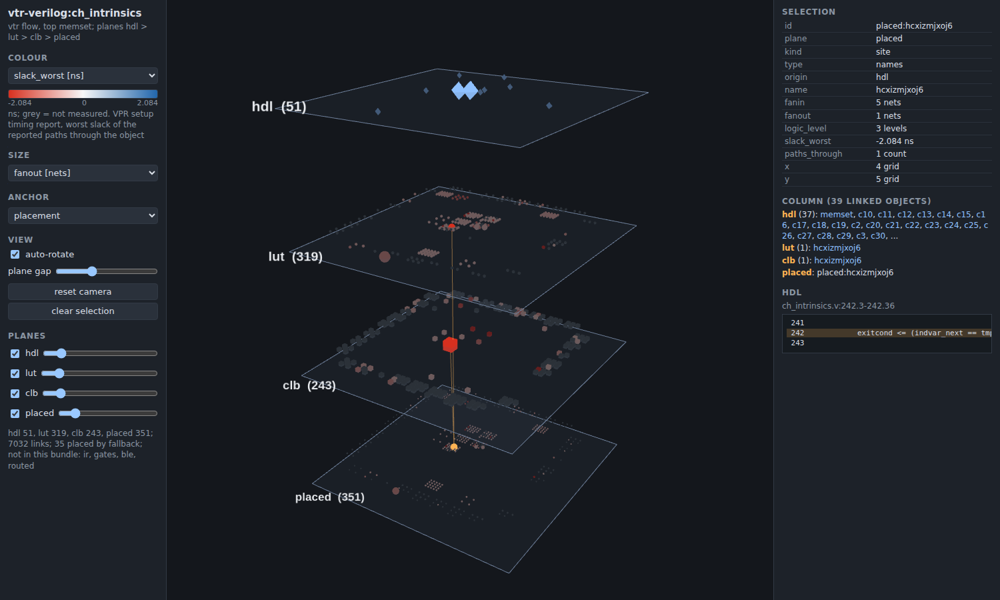
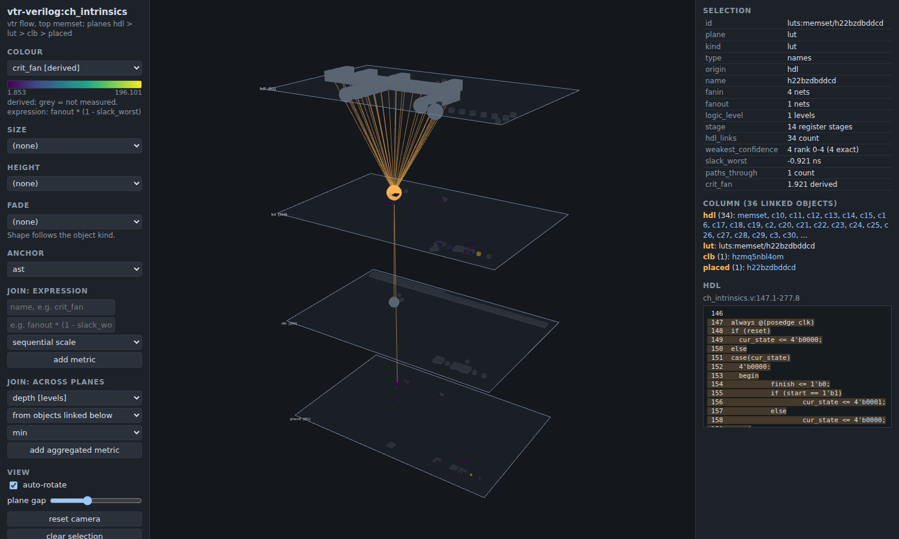

# o3viz: the 3D provenance viewer

o3viz shows one benchmark as a stack of planes in a web browser: the HDL constructs on top, then the LUTs
Odin III made, the VPR clusters, and the placed atoms on the real FPGA grid at the bottom. Each plane can be
coloured and sized by any measured parameter, and a click on an object highlights its column through all the
planes and shows the HDL lines behind it. Design: `docs/specs/2026-11-03-o3viz-design.md`.

## Make a bundle

Run the benchmark through the Odin III flow with provenance and keep VPR's files, then add the placement
records and the step files (the Odin III tools are `odin3-flow`, `odin3-prov-post`, `odin3-prov-steps`):

    odin3-flow design.v --prov --keep-results --out RUN
    odin3-prov-post RUN
    odin3-prov-steps RUN
    wyrd viz export RUN --out design.o3viz --benchmark vtr-verilog:design --src DIR_WITH_design.v

The bundle is a directory of JSON files (`manifest.json`, `planes/`, `links.json`, `edges/`, `anchors/`, `hdl/`),
deterministic: exporting twice gives the same bytes. A value that was not measured is `null` and shows grey.

## View it

    wyrd viz serve design.o3viz            # prints http://127.0.0.1:8765/ ; open it in a browser

Everything is served locally; three.js is vendored (`wyrd/o3viz/web/vendor`, MIT), nothing is fetched from a
network.

- Drag to rotate, wheel to zoom, right-drag to pan; "auto-rotate" and "plane gap" are in the left panel.
- Colour: any metric. Slack uses a diverging scale (red is negative). Grey means not measured.
- Size: any metric.
- Click an object: the right panel shows its fields and metrics, the objects of its column per plane (click one
  to jump), and the HDL span with the source lines. Click empty space to clear.
- Planes can be hidden and their opacity changed.

## What a plane is

| Plane | Objects | Position under the `placement` anchor |
|---|---|---|
| `hdl` | HDL constructs (module, block, statement) from the step file `read` | centroid of the LUTs whose chain reaches it |
| `lut` | nets and LUTs of the mapped netlist (step file `map`) | the placed atom with the same name |
| `clb` | VPR top-level blocks (logic clusters, IO pads, memories) from the `.net` | centroid of the atoms inside |
| `placed` | one per atom (step file `place`) | the real VPR grid tile of its cluster, spread inside the tile |

Planes that Odin III's step files do not write yet (`ir`, `gates`, `ble`, `routed` in v1.4) are not shown; the
manifest lists them as missing. Objects with no placed atom (nets that mapping removed) are put at the mean of
their placed neighbours or the grid centre and counted as `unanchored` in the manifest.

## Anchors (layouts)

The anchor decides where each object sits on its plane; the dropdown switches it without reloading.

- `placement`: the real grid at the bottom; upper planes at the centroid of what they link to.
- `ast`: the HDL construct tree (tidy tree, root on top, one leaf per column); a LUT sits at its deepest
  construct, a cluster at the mean of its LUTs, a placed atom with its LUT.
- `pipeline`: x = register stage (a flip-flop or a block output adds one to the deepest input stage), one square
  block per stage, atoms ordered by logic level inside it; upper planes at the centroid.
- `level`: x = logic level (LUT depth from inputs and register or block outputs), one square block per level,
  atoms ordered by worst slack inside it (worst first, not measured last). It is not yet slack-weighted.

Objects that have no position of their own (a net that mapping removed, an IO pad with no placed atom in an anchor
that needs one) are moved to a strip below the plane and counted in the manifest; a guess is never drawn as a
measurement.

## Channels and joins

Colour, size, height above the plane and fade (blend to the background) take any metric; the shape follows the
object kind. Two joins build new metrics, which then appear in every dropdown:

- Expression: a name and a formula over metric names, for example `fanout * (1 - slack_worst)`. Operators
  `+ - * / % ^`, comparisons, and `abs sqrt log log2 exp floor ceil round min max pow clamp if`. It is parsed by
  a small parser of its own (`wyrd/o3viz/web/expr.js`, no `eval`). A missing value gives a missing result.
- Across planes: `min`, `max`, `mean`, `sum` or `count` of a metric over the objects linked below (for an HDL
  construct, its LUTs) or above (for a LUT, its constructs). Direct links only, one hop.

## Metrics

Measured by Odin III's BLIF or VPR files, never invented: `fanin`, `fanout`, `logic_level` (LUT depth from
inputs and register or block outputs), `stage`, `slack_worst` and `paths_through` (VPR's worst 100 setup paths: the
worst slack of the paths through the object; objects on no reported path stay grey), `atoms`, `luts_inside`,
`ffs_inside`, `x`, `y`, and from the step files `depth`, `children`, `span_lines`, `luts_below`, `hdl_links` and
`weakest_confidence`.

## Test

    .venv/bin/python -m unittest tests.test_o3viz tests.test_o3viz_viewer -v
    node --test tests/js/expr.test.mjs                                # the expression language
    python tools/o3viz_shot.py BUNDLE out.png --colour slack_worst   # needs playwright + chromium
